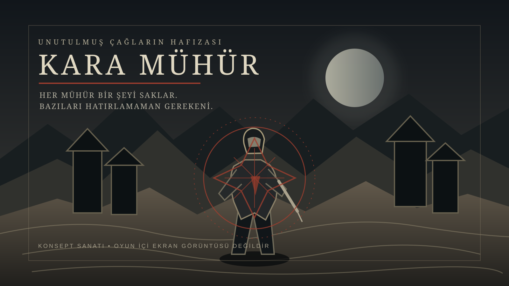
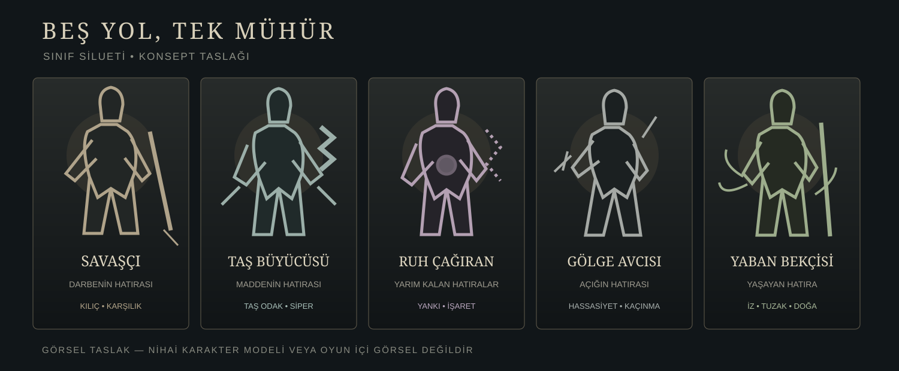
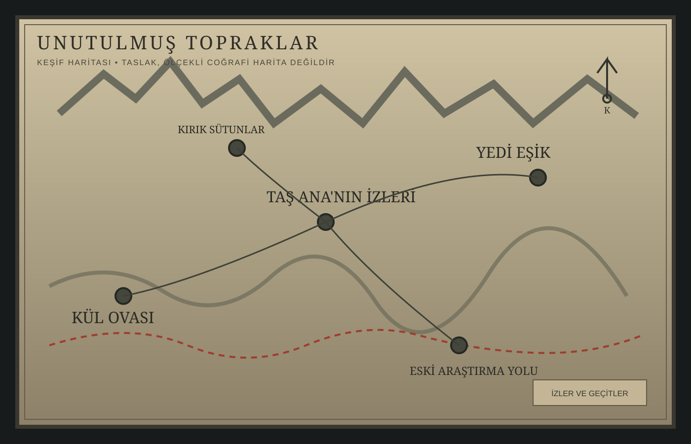
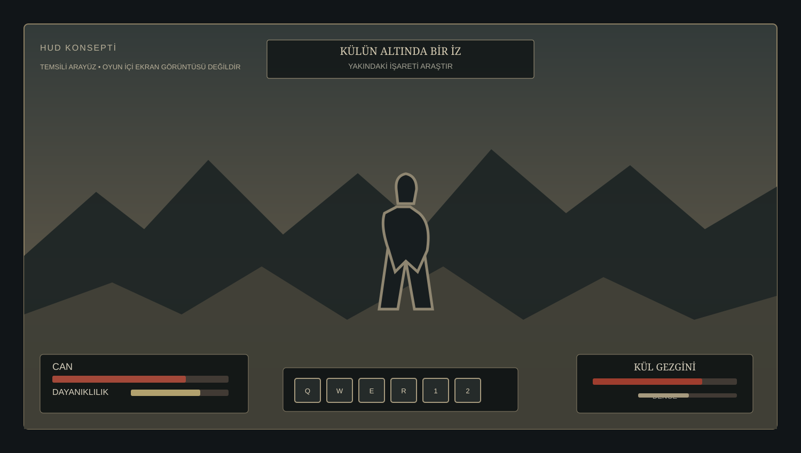
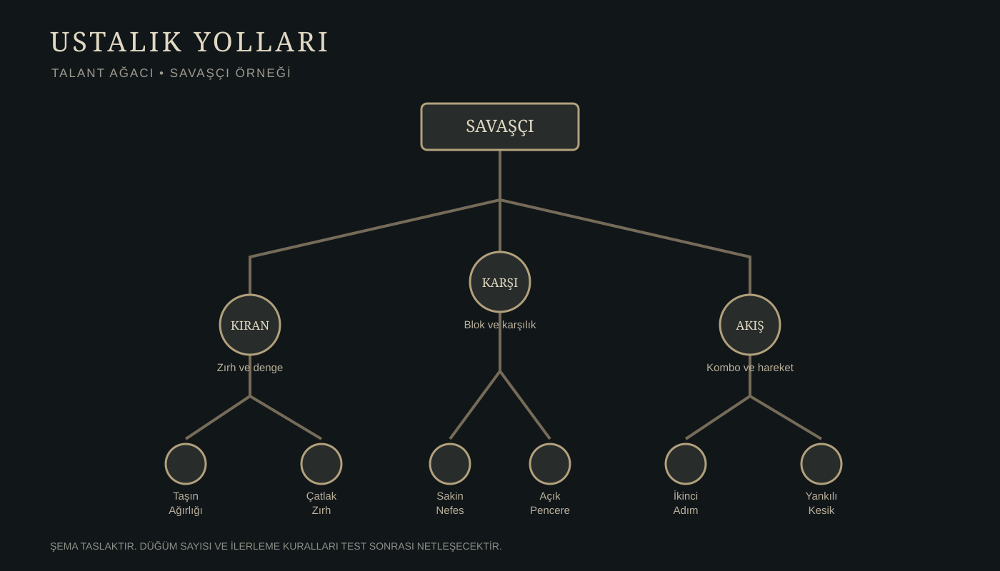

# KARA MÜHÜR
### Anadolu'nun unutulmuş çağlarında geçen karanlık fantastik bir aksiyon RPG

> Her mühür bir şeyi saklar. Bazılarıysa hatırlamaman gereken şeyi.

**Kara Mühür**, mitolojik çağların bilinmeyen Anadolu'sunda geçen; keşif, yakın dövüş, kadim sırlar ve hafıza üzerine kurulu tek oyunculu, çevrimdışı, izometrik bir karanlık fantastik aksiyon RPG projesidir.

Dünya; Anadolu'nun kadim kültürlerinden, taş mimarisinden, sözlü anlatı geleneğinden ve tekinsiz halk inanışlarından esinlenir. Gerçek tarihsel toplulukları doğrudan yeniden anlatmak yerine, bu izlerden beslenen özgün uygarlıklar ve **İlk İz** adı verilen kendine ait bir mitoloji kurar.

## Konsept görselleri

| Sınıflar | Dünya haritası |
|---|---|
|  |  |

| HUD taslağı | Talant ağacı |
|---|---|
|  |  |

> Bu SVG'ler özgün, düzenlenebilir konsept çizimleridir. Nihai karakter modeli veya oynanabilir oyundan alınmış ekran görüntüsü değildir.

## Oyunun özü
- **Tür:** İzometrik karanlık fantastik aksiyon RPG
- **Oynanış:** Tek oyunculu, çevrimdışı
- **Dil:** Türkçe
- **Dünya:** Kurgusal, mitolojik Anadolu
- **Temalar:** Hafıza, kayıp, bedel, kader, unutulmuş uygarlıklar
- **Sınıflar:** Savaşçı, Taş Büyücüsü, Ruh Çağıran, Gölge Avcısı, Yaban Bekçisi
- **Savaş:** hızlı aksiyon, okunabilir saldırılar; sıradan düşmanlar birkaç anlamlı vuruş ister
- **Ölüm:** kalıcı ölüm ve karakter kaybı yok
- **Tasarım ilkesi:** Okunabilir çatışma, anlamlı ilerleme ve ölçülü sayısal değerler

## Hikâyeye kısa bakış
Kahraman, geçmişini hatırlamadan Kül Ovası'nda uyanır. Elinde kalan izler onu eski bir araştırmacının çalışmalarına ve dünyanın derinliklerine gömülmüş **Kara Mühür**'ün sırrına götürür. Geçmiş, yalnızca yaşanmış olaylardan ibaret olmayabilir: tüm canlıların anılarını taşıyan **İlk İz**, hâlâ dünyaya dokunan bir bilinç olabilir.

Kahraman geçmişte mührü kapatmış ve kendi anılarını da mühürlemiştir. Yolculuk, yalnızca bir mührü bulmak değil; neyin hatırlanmayı hak ettiğine ve bazı gerçeklerin yeniden açılmasının bedeline karar vermektir.

## Tasarım sütunları
1. **Gizem, açıklamadan önce gelir.** Dünya çevre, ses, mimari ve çelişkili hatıralarla anlatılır.
2. **Her sınıf ayrı oynanır.** Sınıf seçimi yalnızca görsel değişiklik değil, farklı taktik döngüdür.
3. **Sayılar küçük kalır.** Güç artışı kontrolsüz büyümez; silahlar hasar, hız ve menzil arasında ödünleşim taşır.
4. **Düşmanlar okunur.** Saldırı niyeti görsel ve işitsel ipucuyla anlaşılır.
5. **Keşif ödül verir.** Gizli alanlar yalnızca ganimet değil, dünyanın yorumunu da değiştirir.

## Tasarım belgeleri

### Dünya ve anlatı
- [Dünya ve atmosfer](docs/world-and-atmosphere.md)
- [Hikâye ve mitoloji](docs/story-and-mythology.md)
- [Bölgeler, zindanlar ve keşif](docs/regions-dungeons-and-map.md)
- [Görev kataloğu ve hikâye akışı](docs/quest-catalog.md)
- [Yaratıklar ve boss tasarımı](docs/enemies-and-bosses.md)
- [Sözlük](docs/glossary.md)

### Karakter ve oynanış sistemleri
- [Ana karakter ve önemli figürler](docs/characters-and-npcs.md)
- [Karakterler ve beş sınıf](docs/characters-and-classes.md)
- [Savaş, istatistikler ve denge](docs/combat-and-stats.md)
- [Yetenekler, dallar ve talantlar](docs/skills-and-talents.md)
- [İlerleme ve karakter yapıları](docs/progression-and-builds.md)
- [Silahlar, zırh, eşyalar ve ganimet](docs/weapons-armor-and-loot.md)
- [Sistemler ve ek mekanikler](docs/systems-and-mechanics.md)
- [Arayüz, HUD ve erişilebilirlik](docs/ui-hud-and-accessibility.md)

### Üretim ve yön
- [Görsel sanat rehberi](docs/visual-art-bible.md)
- [Teknik yön ve prototip planı](docs/technical-plan-and-prototype.md)
- [Tasarım inceleme kontrol listesi](docs/design-review-checklist.md)
- [Tasarım ilkeleri ve yol haritası](docs/design-pillars-and-roadmap.md)
- [Katkı rehberi](CONTRIBUTING.md)

## Sayısal tasarım kuralı
Hasar, can, zırh, direnç ve seviye ilerlemesi oyuncunun zihninde takip edilebilir kalmalıdır. Endgame dahil hiçbir sistem kontrolsüz biçimde milyonlara çıkan sayılar veya aşırı güç şişmesi üretmemelidir. Güç, yalnızca büyük sayılarla değil; zamanlama, pozisyon, direnç, yetenek etkileşimi ve oyuncu ustalığıyla hissedilmelidir.

## Üretim yaklaşımı
Bu depo, Kara Mühür'ün dünya kurgusunu, oynanış sistemlerini, görsel yönünü ve üretim planını bir araya getiren proje kaynağıdır. Teknik kararlar, dikey dilim yaklaşımı ve oynanış testleriyle doğrulanacak şekilde ele alınır.

## Kapsam ve durum
Kara Mühür bir geliştirme projesidir. Bu depo; dünya, hikâye, sınıflar, savaş, yetenekler, eşya tasarımı, görevler, düşmanlar, arayüz ve görsel yön için yaşayan tasarım kaynağıdır. Taslak sayılar ve sistemler prototip testleriyle doğrulanacaktır.
